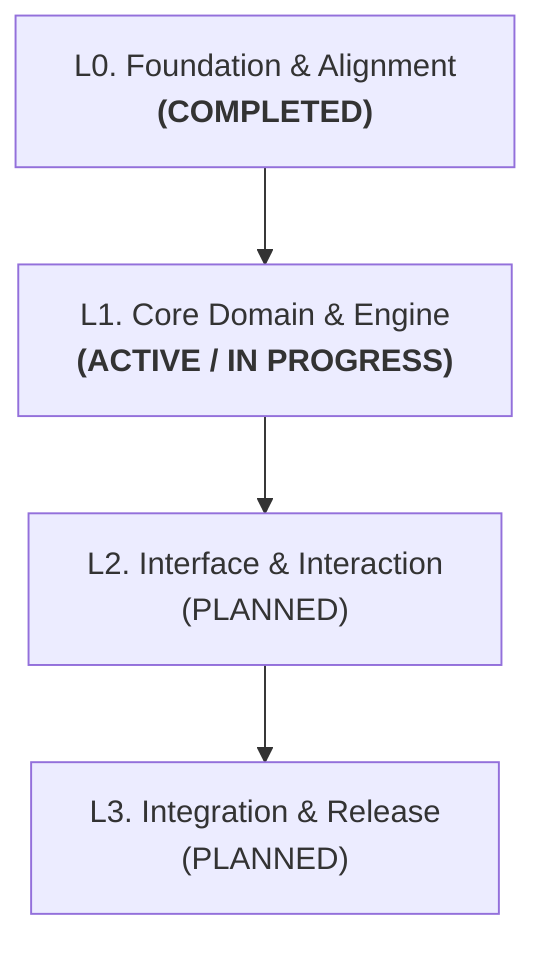

# Layer-Driven Development (LDD) 🚀

[](https://opensource.org/licenses/MIT)
[](https://skills.sh)
[](https://github.com)

**Layer-Driven Development (LDD)** is an agentic software engineering framework that turns complex, multi-stage projects into structured, progressive layers with living documentation and zero-friction execution.

Designed for AI pair-programming (Antigravity IDE, Claude Code, Cursor, and agentic workflows), LDD solves two common failure modes in AI-assisted development:
1. **The Over-Planning Trap:** Trying to design 100% of a complex system upfront before building a single prototype.
2. **The Amnesia Trap:** Context drift and lost architectural intent as conversations stretch across multiple sessions.

---

## 🌟 The Core Philosophy



1. **Consolidated Layers:** We only detail and execute the **active layer**. Future layers remain macro milestones until activated.
2. **Living Documentation:** Every technical trade-off is recorded in real time as an ADR (`docs/adr/`), domain terms are codified in `CONTEXT.md`, and macro status is tracked in `ROADMAP.md`.
3. **Clean Separation of Concerns:**
   - 🗺️ **Roadmap:** High-level project trajectory (`ROADMAP.md`).
   - 🎯 **Layer Backlog:** Concrete operational Steps and Tasks (`docs/layers/lN-<name>.md`).
   - 🏁 **Results & Balance:** Formal retrospectives that certify layer completion (`docs/results/lN-results.md`).
   - ⚖️ **Architecture Decisions:** Irreversible decisions and trade-offs (`docs/adr/000X-<slug>.md`).
   - 🔬 **Discoveries:** Research, benchmarks, and exploratory tests (`docs/discoveries/<topic>.md`).
   - 📏 **Business Rules:** Deterministic rules, invariants, and specs (`docs/business-rules/<topic>.md`).
4. **Proactive Agent Initiative:** The agent doesn't sit idle waiting for repetitive prompts. When a task is marked `[x]`, the agent provides a milestone summary and immediately proposes the next step.

---

## 📦 Installation

### Option 1: Via Skills CLI (`skills.sh`)

Install globally for your AI agent environment with a single command:

```bash
npx skills add eduardo-de-bastiani/layer-driven-development -g -y
```

### Option 2: Manual Clone for Antigravity IDE

Clone directly into your global customizations directory:

```bash
git clone https://github.com/eduardo-de-bastiani/layer-driven-development.git ~/.gemini/config/skills/layer-driven-development
```

Or install locally in a specific workspace:

```bash
git clone https://github.com/eduardo-de-bastiani/layer-driven-development.git .agents/skills/layer-driven-development
```

---

## ⚡ How to Use: The Universal `/ldd` Command

LDD introduces a single contextual command: **`/ldd`**.

- **In a fresh project:** `/ldd` starts the **Project Genesis** flow (interviewing you to understand your scope, proposing 3 to 7 tailored layers, and generating the folder scaffolding).
- **In an active layer:** `/ldd` (or saying *"let's continue developing the layer"*) immediately finds the next pending task (`- [ ]`) in `docs/layers/lN-*.md` and executes it.
- **When all tasks in a layer are done:** The agent proactively proposes closing the layer, generating `docs/results/lN-results.md`, reviewing ADRs, and opening the next layer.

---

## 🤝 Recommended Companion Skills

LDD is completely **self-contained with built-in fallbacks**, meaning it functions out of the box with zero external dependencies.

However, to elevate your development experience to the highest engineering standard, we strongly recommend pairing LDD with these two essential companion skills by **Matt Pocock**:

| Companion Skill | Install Command | Why It Elevates LDD |
| :--- | :--- | :--- |
| **`grilling`** | `npx skills add mattpocock/skills@grilling` | **Essential for Layer Opening:** Conducts relentless design-tree interviews to stress-test requirements, boundary conditions, and guardrails before coding begins. |
| **`domain-modeling`** | `npx skills add mattpocock/skills@domain-modeling` | **Essential for ADRs & Glossary:** Maintains a strict, canonical `CONTEXT.md` vocabulary and triggers ADRs only when decisions are hard-to-reverse, surprising, or involve genuine trade-offs. |

*Note: LDD dynamically detects these skills. If installed, it delegates to them; if not, it seamlessly runs its own built-in questioning and documentation protocols.*

---

## 📐 Project Directory Structure

When initialized by LDD, your repository will maintain this clean English structure:

```text
<project-root>/
├── ROADMAP.md                  # Master roadmap, Mermaid diagram, layer statuses, transition protocol
├── CONTEXT.md                  # Canonical domain glossary and entity relationships
├── AGENTS.md                   # Operational guidelines and invariants for agents
└── docs/
    ├── layers/                 # Dedicated layer planning & checklists (e.g., l0-foundation.md, l1-core.md)
    ├── results/                # Formal layer closure reports (e.g., l0-results.md, l1-results.md)
    ├── discoveries/            # Research, benchmarks, API explorations, interviews
    ├── adr/                    # Architecture Decision Records (0001-two-stage-pipeline.md)
    └── business-rules/         # Deterministic business rules, invariants, and specifications
```

---

## 📄 License

This project is licensed under the **MIT License** — see the [LICENSE](./LICENSE) file for details.

Developed with passion by **[Eduardo De Bastiani](https://github.com/eduardo-de-bastiani)**.
