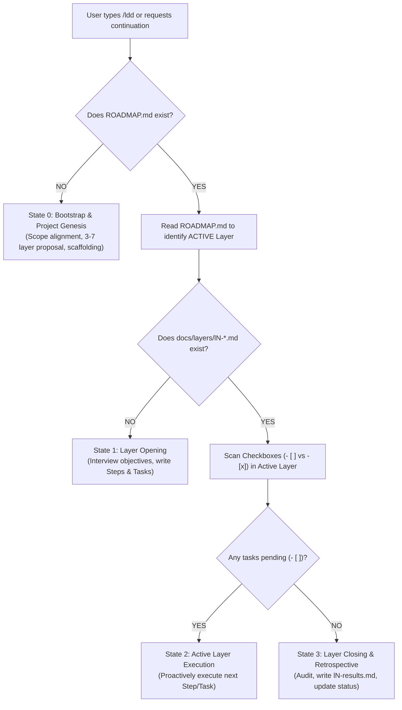

# Layer-Driven Development (LDD)

**Layer-Driven Development (LDD)** is an agentic software engineering framework that turns complex, multi-stage projects into structured, progressive layers with living documentation and zero-friction execution.

Instead of vague roadmaps or chaotic sprint boards, LDD operates on **consolidated layers**: an active layer is executed step-by-step with actionable checklists, while future layers remain high-level until activated. Every layer produces formal, persistent documentation:
- 🗺️ **Macro Roadmap:** [`ROADMAP.md`](./ROADMAP.md) (Layer statuses, transition protocol, Mermaid diagram)
- 📖 **Domain Glossary:** [`CONTEXT.md`](./CONTEXT.md) (Ubiquitous vocabulary without implementation clutter)
- 🎯 **Layer Backlog:** `docs/layers/lN-<name>.md` (Sequential Steps & actionable Tasks `- [ ]`)
- 🏁 **Closure Retrospective:** `docs/results/lN-results.md` (Formal balance and criteria verification)
- ⚖️ **Architectural Decisions:** `docs/adr/000X-<slug>.md` (Irreversible trade-offs)
- 🔬 **Empirical Research:** `docs/discoveries/<topic>.md` (Benchmarks and investigative findings)
- 📏 **Domain Logic:** `docs/business-rules/<topic>.md` (Deterministic rules & invariants)

---

## ⚡ The `/ldd` Contextual Dispatch Loop

When the user types `/ldd` or uses natural phrasing (*"continue developing the layer"*, *"open next layer"*, *"what is the project status?"*), execute this state resolution flow:



---

## 🛠️ Execution Protocol by State

### State 0: Bootstrap & Project Genesis
*Triggered when `ROADMAP.md` does not yet exist.*

1. **Companion Skills Inspection (Polite & Transparent):**
   - Check if `grilling` and `domain-modeling` are available in the environment.
   - If missing, offer a friendly, optional tip:
     > *"💡 Tip: For sharper boundary interviews and domain glossaries, we recommend Matt Pocock's skills (`npx skills add mattpocock/skills@grilling` and `npx skills add mattpocock/skills@domain-modeling`). Would you like to install them, or proceed with LDD's built-in engine?"*
   - Never install anything silently. If the user declines or ignores, proceed seamlessly using LDD's built-in interview protocols.
2. **Project Understanding & Scope Alignment:**
   - Explore existing codebase (if any) or ask clarifying questions about goals, key users, and core technical challenges.
   - If `grilling` is available, invoke it. Otherwise, interview the user using a structured design tree.
3. **Pragmatic Layer Proposal (Adaptive Sizing):**
   - Propose a lean, tailored set of **3 to 7 macro-layers** (never inflate to 10+ layers unless enterprise-mandated).
   - *Example for Focused Project (3-4 layers):*
     - `L0: Foundation & Setup` ➔ `L1: Core Engine & Data` ➔ `L2: UI & User Flows` ➔ `L3: Integration & Release`
   - *Example for End-to-End System (5-7 layers):*
     - `L0: Foundation & Alignment` ➔ `L1: Discovery & Technical POC` ➔ `L2: Local Prototype` ➔ `L3: Validation & Business Rules` ➔ `L4: Cloud Architecture & Persistence` ➔ `L5: MVP Pilot`
   - Ask: *"Does this roadmap cover all areas you want to build, or should we adjust any layer boundaries?"*
4. **Scaffolding:**
   - Create directories: `docs/layers/`, `docs/results/`, `docs/discoveries/`, `docs/adr/`, `docs/business-rules/`.
   - Instantiate `ROADMAP.md` from `resources/templates/ROADMAP-template.md`.
   - Instantiate `CONTEXT.md` with initial domain terms.
   - Instantiate `AGENTS.md` specifying living documentation rules.

---

### State 1: Layer Opening
*Triggered when a layer is set to active in `ROADMAP.md` but has no dedicated file in `docs/layers/`.*

1. **Layer Refinement:**
   - Align on the layer's primary objective, prerequisites, dependencies, and explicit exit criteria.
   - Define explicit guardrails: **"What NOT to do in this layer"** (critical to prevent scope creep).
2. **Sequential Steps & Tasks:**
   - Break the layer down into logical **Steps** (e.g., `Step 1: Data Contracts`, `Step 2: Engine Implementation`, `Step 3: Verification`).
   - Populate actionable checklist tasks (`- [ ]`) under each step.
3. **Instantiate Layer File:**
   - Create `docs/layers/lN-<slug>.md` using `resources/templates/LAYER-template.md`.
   - Present the layer outline to the user and proactively suggest starting Task 1.1.

---

### State 2: Active Layer Execution (Proactive Progression)
*Triggered when an active layer has pending tasks (`- [ ]`).*

1. **Locate Pending Work:**
   - Identify the active layer and the first incomplete checkbox (`- [ ]`).
2. **Execute with Quality Seams:**
   - Implement the required code, tests, or documentation.
   - Run typechecks and automated tests to verify functionality.
3. **Handle Architectural Trade-offs (ADRs):**
   - If an irreversible or high-impact decision is made during implementation:
     - If `domain-modeling` is available, invoke it.
     - Otherwise, create `docs/adr/000X-<slug>.md` using `resources/templates/ADR-template.md`.
     - Link the ADR in the active layer document.
4. **Handle Research & Benchmarks:**
   - If exploratory research, LLM benchmarks, or competitor evaluations are required, store them in `docs/discoveries/<topic>.md` (referencing `resources/templates/DISCOVERY-template.md`), keeping them cleanly isolated from layer results.
5. **Zero-Friction Proactive Hand-off:**
   - Update the task checkbox to `- [x]` in `docs/layers/lN-<slug>.md`.
   - Provide a concise milestone update (2-3 sentences max).
   - **Immediately propose the next task:** *"Task 1.1 complete! Ready to proceed to Task 1.2: [Description]?"*

---

### State 3: Layer Closing & Retrospective
*Triggered when all tasks in the active layer are marked `- [x]`.*

1. **Proactive Closure Prompt:**
   - When the final task is checked, notify the user:
     > *"All tasks for Layer {N} are complete! Shall we run the formal closure audit and generate `docs/results/lN-results.md` to prepare Layer {N+1}?"*
2. **Quality & Living Documentation Audit:**
   - Verify all test suites pass.
   - Verify that any new ubiquitous domain terms are recorded in `CONTEXT.md`.
   - Verify that all major architectural trade-offs have ADRs in `docs/adr/`.
3. **Generate Layer Results:**
   - Create `docs/results/lN-results.md` using `resources/templates/RESULTS-template.md`.
   - Document completed deliverables, key decisions, lessons learned, and carried-over technical debt.
4. **Update Roadmap:**
   - Update `ROADMAP.md`: mark Layer {N} as `Completed` (or `Partially Completed` if external blockers exist with documented rationale).
   - Set Layer {N+1} as `Active`.
   - Prompt the user to start Layer {N+1} opening.

---

## 🤝 Companion Skills Integration

LDD is designed as a **Meta-Orchestrator**. It works autonomously with built-in fallbacks, but dynamically delegates to top-tier companion skills when available:

| Flow Stage | Companion Skill | Author | Role in LDD | Native Fallback |
| :--- | :--- | :--- | :--- | :--- |
| **Bootstrap & Layer Opening** | [`grilling`](https://github.com/mattpocock/skills) | Matt Pocock | Relentless design-tree interview to surface hidden prerequisites and trade-offs. | Built-in structured questioning based on frontier decisions. |
| **Domain Glossary & ADRs** | [`domain-modeling`](https://github.com/mattpocock/skills) | Matt Pocock | Maintains canonical `CONTEXT.md` vocabulary and validates when an ADR is warranted. | Local creation of `CONTEXT.md` and ADR template population. |

---

## 📐 Canonical Directory Standard (100% English)

```text
<project-root>/
├── ROADMAP.md                  # Master roadmap, Mermaid diagram, layer statuses, transition protocol
├── CONTEXT.md                  # Canonical domain glossary and entity relationships
├── AGENTS.md                   # Operational guidelines and invariants for agents
└── docs/
    ├── layers/                 # Dedicated layer planning & checklists (e.g., l0-foundation.md, l1-core.md)
    ├── results/                # Formal layer closure reports (e.g., l0-results.md, l1-results.md)
    ├── discoveries/            # Research, benchmarks, API explorations, interviews
    ├── adr/                    # Architecture Decision Records (0001-two-stage-pipeline.md)
    └── business-rules/         # Deterministic business rules, invariants, and specifications
```

---

## 💡 Best Practices & Living Rules

1. **Zero Hallucinated Scope:** An agent should never invent tasks outside the active layer document. If a brilliant idea emerges that is out of scope, log it in `ROADMAP.md` under a future layer or in `docs/results/` as carried-over debt.
2. **Keep `CONTEXT.md` Clean:** Do NOT put implementation details or technical stacks in `CONTEXT.md`. It is strictly a domain vocabulary glossary.
3. **Separate Discoveries from Results:** Benchmarks and exploratory scripts belong in `docs/discoveries/`. Formal closure evaluations belong in `docs/results/`.
4. **Pragmatic Layer Sizing:** Adapt to project scale. A 2-day micro-service should have 3 layers. An end-to-end platform should have 5-7 layers. Avoid layer inflation.
