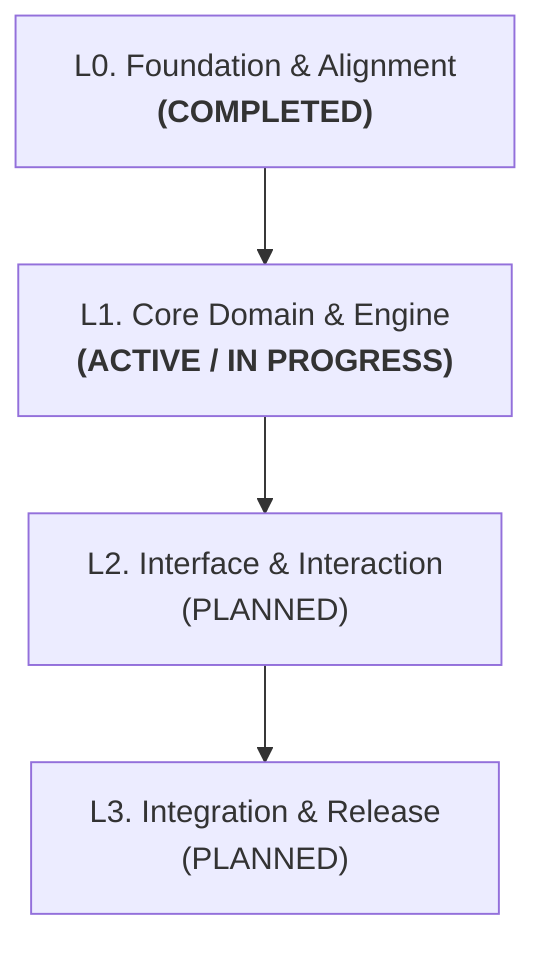

# Roadmap — [Project Name]

**Product:** [Project / Product Name]  
**Organization / Owner:** [Organization or Author]  
**Current Status:** Layer 0 Completed | Layer 1 Active (In Progress)  

> [!IMPORTANT]
> **The Core Principle of Layer-Driven Development (LDD):**  
> This document is the single source of truth for the project's macro lifecycle. It operates by **consolidated layers**: we only advance to the next layer once the objective exit criteria of the active layer are formally evaluated, recorded, and approved. We do not over-specify distant future layers upfront — deep operational planning and task execution belong strictly inside the dedicated file of the currently active layer (`docs/layers/lN-<name>.md`).

---

## 🔄 Operational Transition Protocol

To ensure seamless execution across new sessions, agents, and contributors, every layer transition MUST follow this strict two-step protocol:

### 1. Closing the Active Layer (Recording & Retrospective)
- **Closure Document:** Consolidate layer results into `docs/results/lN-results.md`.
- **Mandatory Contents:**
  1. Executive summary of completed deliverables;
  2. Architectural decisions taken and references to new ADRs in `docs/adr/`;
  3. Updates to canonical domain vocabulary in `CONTEXT.md`;
  4. Changes to business rules or specifications driven by lessons learned;
  5. Unresolved debt, open edge cases, and items deferred to future layers.
- **Status Update:** Formally update layer status in this `ROADMAP.md` (e.g., `Completed` or `Partially Completed` with documented rationale).

### 2. Opening the Next Layer (Scoping & Activation)
- **Dedicated Layer Document:** Create `docs/layers/l{N+1}-<layer-name>.md`.
- **Mandatory Contents:**
  1. Layer objective and alignment with roadmap goals;
  2. Input requirements, dependencies, and available artifacts;
  3. Sequential execution backlog organized into **Steps** with actionable **Tasks** (`- [ ]`);
  4. Measurable exit criteria;
  5. Explicit guardrails: **"What NOT to do in this layer"** to prevent scope creep.
- **Agent Handoff:** Any new agent session begins by reading `ROADMAP.md` and the active layer file in `docs/layers/` to immediately resume the pending checklist without hallucinating scope.

---

## 🗺️ Layer Architecture Diagram

---

## 📋 Macro Layer Breakdown

### L0 — Foundation & Alignment *(COMPLETED)*
- **Objective:** Establish shared context, canonical domain vocabulary, core architectural decisions, and repository scaffolding.
- **Key Deliverables:**
  - [x] Canonical domain glossary in [`CONTEXT.md`](./CONTEXT.md)
  - [x] Architectural decisions recorded in [`docs/adr/`](./docs/adr/)
  - [x] Initial repository setup and runtime configuration
- **Closure Report:** Available at [`docs/results/l0-results.md`](./docs/results/l0-results.md)

### L1 — Core Domain & Engine *(ACTIVE)*
- **Objective:** Build core business logic, deterministic pipelines, and primary data structures with high test coverage.
- **Active Document:** Refer to [`docs/layers/l1-core-engine.md`](./docs/layers/l1-core-engine.md) for current steps and tasks.

### L2 — Interface & User Experience *(PLANNED)*
- **Objective:** Implement user interface, interactions, feedback states, and client integration with the core engine.
- **Prerequisite:** L1 exit criteria fulfilled.

### L3 — Integration & Release Readiness *(PLANNED)*
- **Objective:** End-to-end testing, security validation, performance benchmarks, and release delivery.
- **Prerequisite:** L2 exit criteria fulfilled.
